<div align="center">

# 🛍️ Stylish
### *Modern React Native Shopping App*

<p align="center">
  
  
  
  
  
</p>

<p>
A beautifully crafted <b>cross-platform shopping application</b> built with
<b>React Native (Expo)</b>, inspired by a premium Figma UI Kit.
Designed with smooth navigation, modern aesthetics, and a scalable architecture —
with <b>user experience at the heart of every screen</b>.
</p>

---

</div>

# ✨ Preview

<p align="center">

<a href="https://www.figma.com/design/kiAdIJcvnvzg87W2wbxkIw/eCommerce-App-UI-Kit---Case-Study-Ecommerce-Mobile-App-UI-kit--Community-?node-id=1-16990&p=f&m=dev">


</a>

</p>

---

# 📱 Application Screens

<div align="center">

### 🚀 App Launch Experience

| Splash | Onboarding 1 | Onboarding 2 | Onboarding 3 |
|:------:|:------------:|:------------:|:------------:|
| 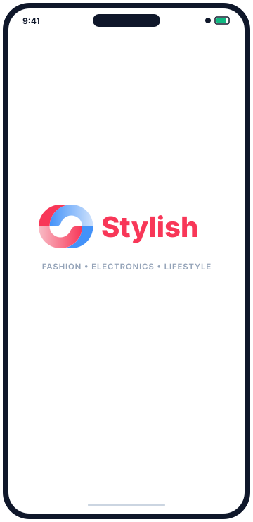 | 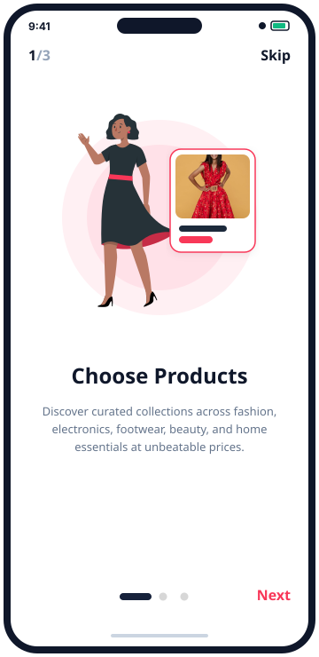 | 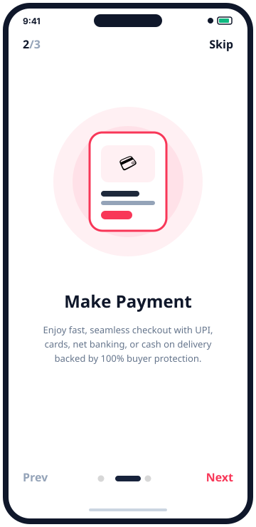 | 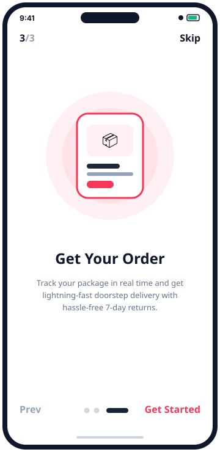 |

<br>

### 🔐 Authentication & User

| Login | Sign Up | Wishlist | Profile |
|:------:|:-------:|:---------:|:--------:|
| 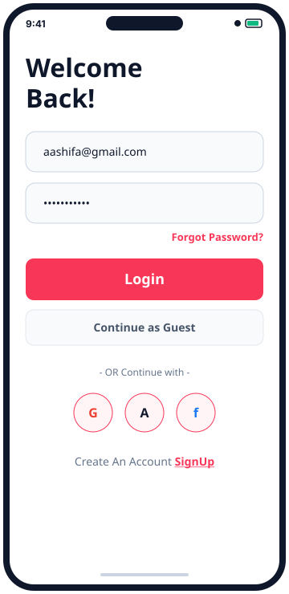 | 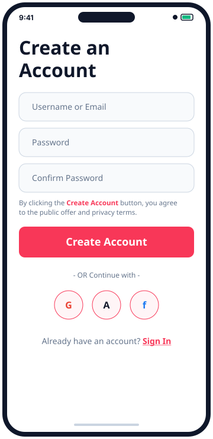 | 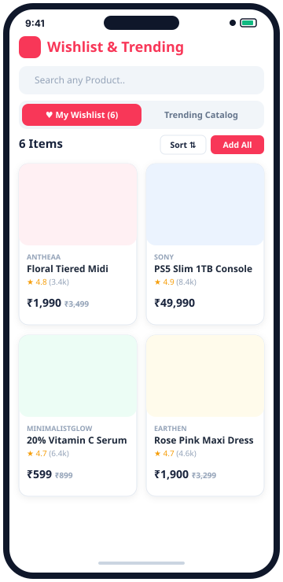 | 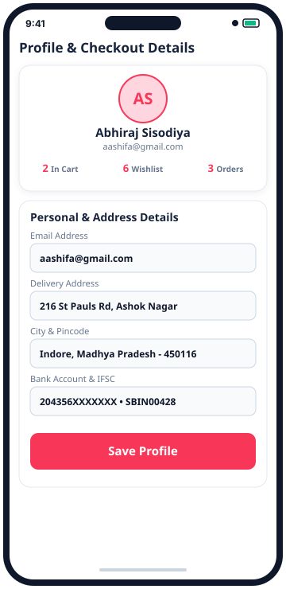 |

<br>

### 🛍️ Shopping & Checkout Experience

| Home Screen | Product Details | Shopping Cart | Order Confirmed |
|:-----------:|:---------------:|:-------------:|:---------------:|
| 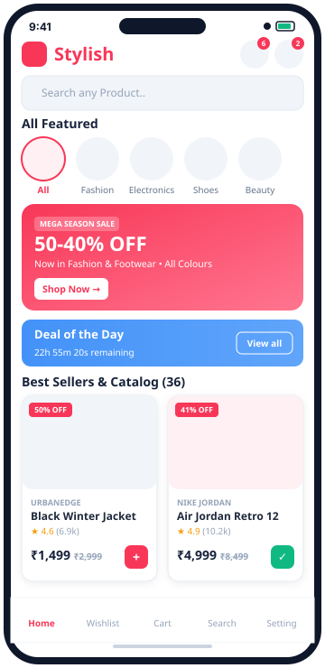 | 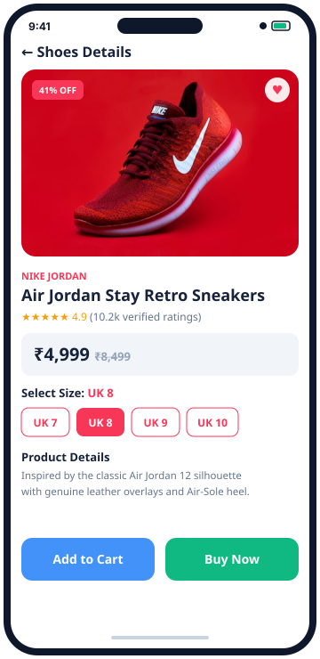 | 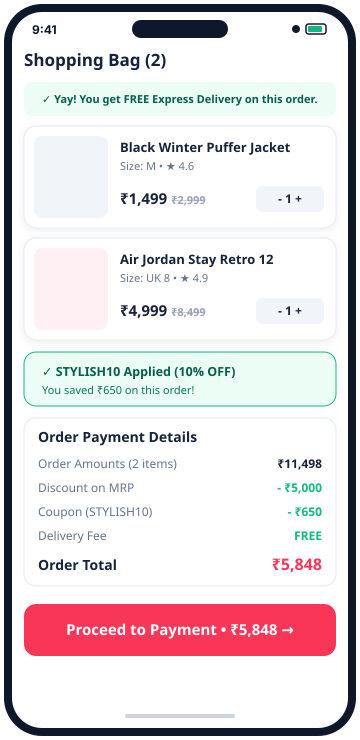 | 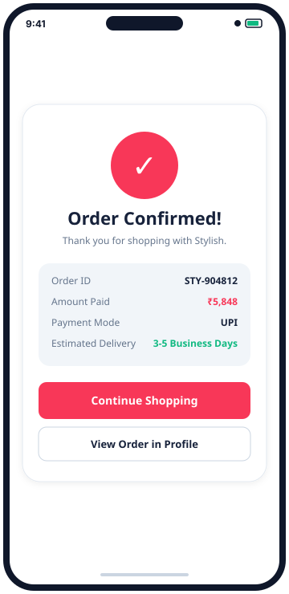 |

</div>

---

# 🎯 User Experience Highlights

Stylish isn't just built to look good — it's built to *feel* good to use. Every screen follows a few core UX principles:

<table>
<tr>
<td width="50%">

### 🧭 Effortless Navigation
- 👆 One-hand friendly bottom tab layout
- 🔄 Consistent back/forward gestures across screens
- 📍 Clear visual feedback on active tab & state

</td>
<td width="50%">

### ⚡ Fast, Frictionless Flows
- 🏁 3-step onboarding — skippable anytime
- 🛒 Add-to-cart in a single tap
- 💨 Minimal taps from browse → checkout

</td>
</tr>
<tr>
<td width="50%">

### 🎨 Clarity First Design
- 🔤 Readable typography with strong visual hierarchy
- 🌗 High-contrast UI for easy scanning
- 🧩 Familiar iconography — no learning curve

</td>
<td width="50%">

### 💬 Helpful Feedback
- ✅ Instant confirmation on actions (added to cart, wishlist, etc.)
- ⚠️ Friendly, clear error/empty states
- ⏳ Smooth loading states, no jarring jumps

</td>
</tr>
</table>

### ♿ Accessibility & Inclusivity
- Designed with legible font sizes and comfortable tap-target spacing
- Color choices tested for readability and contrast
- Roadmap includes screen-reader friendly labels and dynamic text scaling

### 🧑‍🤝‍🧑 Built Around Real User Needs
- **New users** get a guided, skippable onboarding — no forced friction
- **Returning users** land straight on a personalized Home screen
- **Casual browsers** can explore freely via Wishlist without committing to checkout
- **Ready-to-buy users** get a short, distraction-free checkout path

---

# ✨ Features

<table>
<tr>
<td width="50%">

### 🛒 Shopping

- 🏠 Home Screen
- 🔍 Smart Search
- ❤️ Wishlist
- 🛍️ Shopping Cart
- 💳 Checkout

</td>

<td width="50%">

### 👤 User

- 🚀 Splash Screen
- 👋 Onboarding
- 🔐 Login
- 📝 Registration
- 👤 User Profile

</td>
</tr>
</table>

---

# 🛠 Tech Stack

| Technology | Purpose |
|------------|---------|
| ⚛ React Native | Cross-platform Development |
| 🚀 Expo | Development Environment |
| 📂 Expo Router | File-based Navigation |
| 💛 JavaScript | Application Logic |
| 🎨 Figma | UI/UX Design |

---

# 📂 Project Structure

```text
app/
│
├── _layout.jsx
├── home.jsx
├── search.jsx
├── cart.jsx
├── wishlist.jsx
├── profile.jsx
│
├── auth/
│   ├── login.jsx
│   └── signup.jsx
│
├── checkout/
│
├── onboarding/
│   ├── splash1.jsx
│   ├── splash2.jsx
│   └── splash3.jsx
│
└── Image/
````

---

# 🚀 Installation

```bash
# Clone Repository
git clone https://github.com/soumitra69/react-native-ecommerce.git

# Install Dependencies
npm install

# Start Expo
npx expo start
```

### 📖 Getting Started (Quick Guide)

1. Make sure you have **Node.js** and the **Expo Go** app (iOS/Android) installed.
2. Run the commands above to install and start the project.
3. Scan the QR code shown in your terminal with Expo Go to launch the app instantly on your phone.
4. That's it — no complex native build setup required to get started! 🎉

---

# 🚀 Upcoming Updates

<div align="center">

### ✨ More Features Coming Soon!

We're actively working on making **Stylish** even better — with a strong focus on making the app easier, faster, and more delightful to use.
Stay tuned for exciting new features and continuous improvements!

</div>

---

## 🗺️ Development Roadmap

| Status | Feature | Progress |
|:------:|---------|:--------:|
| 🟢 | Home Screen Enhancements | Completed |
| 🟢 | Product Details Page | Completed |
| 🟢 | Categories & Filters | Completed |
| 🟢 | Advanced Search | Completed |
| 🟢 | Shopping Cart Improvements | Completed |
| 🟢 | Secure Checkout Flow | Completed |
| 🟡 | Payment Gateway Integration | Simulated (Demo) |
| 🟢 | Order History | Completed |
| 🟡 | Order Tracking | Coming Soon |
| 🟢 | User Profile Management | Completed |
| 🟢 | Wishlist Synchronization | Completed |
| 🟢 | Product Reviews & Ratings | Completed |
| 🟢 | Coupons & Discounts | Completed |
| 🟡 | Push Notifications | Coming Soon |
| 🟡 | Dark Mode | Coming Soon |
| 🟡 | Multi-language Support | Coming Soon |
| 🟡 | Accessibility Improvements (Screen Reader, Text Scaling) | Coming Soon |
| 🟢 | Performance Optimizations | Completed |
| 🟡 | Backend API Integration | Offline + Mock Catalog |

---

<div align="center">

## 💡 Future Vision

🚀 Modern Shopping Experience
💳 Secure Payments
📦 Fast Order Tracking
❤️ Personalized Recommendations
🔔 Smart Notifications
🌙 Beautiful Dark Mode
♿ Accessible to Every User

---

### ⭐ If you like this project, don't forget to Star the repository!


**Made with ❤️ using React Native & Expo**

</div>

---

<p align="center">

### ⚡ Stay Tuned!

**New features and UI improvements are being added regularly.**

⭐ **Star this repository to follow future updates!**

</p>

---

# 🤝 Feedback & Contributions

User feedback shapes this app! If something feels confusing, slow, or could be more intuitive, please open an issue — UX feedback is just as valuable as bug reports.

- 🐛 Found a bug? [Open an issue](https://github.com/soumitra69/react-native-ecommerce/issues)
- 💡 Have a UX suggestion? We'd love to hear it
- 🔧 Want to contribute? Pull requests are welcome

---

# 🌟 Support

If you like this project, please consider giving it a ⭐ on GitHub.

<p align="center">


</p>

---

<div align="center">

### Made with ❤️ using React Native & Expo

</div>
